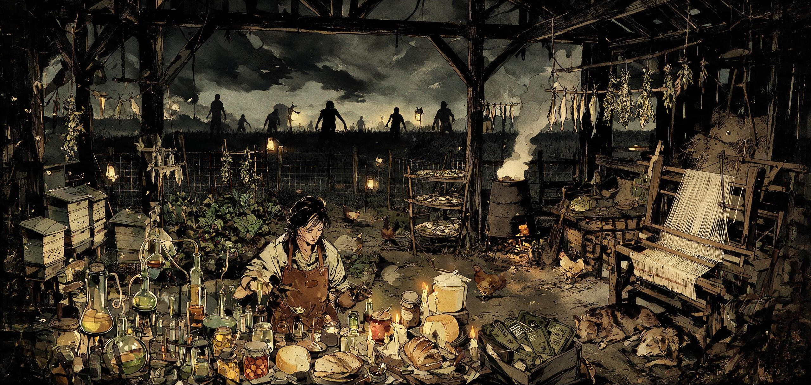

<div align="center">

# Hydrocraft Reinvented

[Русский](#russian) · [English](#english)

### Заново построить мир. Rebuild a living world.

Тысячи предметов и рецептов Hydrocraft на нативных системах Project Zomboid B42


[](docs/RELEASE_1.6.0.md)
[](https://steamcommunity.com/sharedfiles/filedetails/?id=3778201332)

[Установка](#install-ru) · [Ограничения](#limits-ru) · [Документация](#docs-ru) · [Install](#install-en) · [Limits](#limits-en) · [Docs](#docs-en)

</div>



<a id="russian"></a>
## Русский

**Порт классического мега-мода Hydrocraft (B41) на Project Zomboid Build 42.21.0.**
Пчеловодство, ткачество, электроника, химия, шахты, сотни блюд и производственные цепочки — вокруг нативных систем B42.

Оригинал: **Hydromancerx**; поддержка B41: [Hydrocraft Continued team](https://github.com/brosseaualex/Hydrocraft). Порт на B42: **hombrehumor**.

**1.6.0 «Живая вода»** переносит воду, соки, молочные напитки и алкоголь на
native FluidContainer. Переливание сохраняет реальные остатки, свежесть,
питание и яд; партии бродят независимо. Добавлены пшеничное пиво и сезонный
хмель, сохранена миграция старых запасов. Проверено на **42.21.0** в SP и на
сервере с двумя клиентами, включая полный перезапуск.

[Мастерская Steam](https://steamcommunity.com/sharedfiles/filedetails/?id=3778201332) · [ZZZ Industrial Collection](https://steamcommunity.com/sharedfiles/filedetails/?id=3778214259) · [Выпуск и обновление 1.6.0](docs/RELEASE_1.6.0.md) · [Журнал проверок](docs/FLUIDS_1_6_STATUS.md)

### Философия порта: «дополнить, не задублировать»

Build 42 сам добавил многое из того, что Hydrocraft делал в B41. Эти подсистемы
не переносились — их роль теперь играет ваниль:

| Система Hydrocraft B41 | Замена в B42 |
|---|---|
| Кузнечное дело, металлургия | навыки Blacksmith / Melting |
| Гончарство | навык Pottery |
| Камнеобработка, кладка | навыки Masonry / Carving |
| Стекло | навык Glassmaking |
| Костяные изделия | навык Carving |
| Разделка туш | навык Butchering |
| Скот-как-предметы | живые животные (Husbandry) |
| Переплавка металлолома | ванильный Melting |
| Розжиг, компост | ванильные механики |

Общие материалы из вырезанных систем (клеи, ленты, банки — 120 предметов),
на которые ссылается остальной контент, сохранены.

### Что внутри

- **5 384 предмета** — животные и собаки, MRE-пайки, электроника, шахты,
  пасека, ткачество, химия, сотни блюд и напитков
- **3 647 рецептов** — полная
  конвертация в систему `craftRecipe` B42
- **121 схема починки**, 271 модель, 5 696 текстур, 38 звуков, tiledef 591
- **Полная русская локализация**: 100 % предметов, 100 % рецептов,
  все 32 категории крафта; базовые переводы ещё на 9 языков (48 000+ ключей)

### Как это сделано (API B42)

- `recipe` → `craftRecipe` по грамматике ванильных рецептов B42:
  `inputs`/`outputs`, `mode:keep/destroy`, теги инструментов (`base:hammer`,
  `base:saw`…), жидкости через `-fluid`, `SkillRequired`, `xpAward`
- 282 OnCreate-функции работают через мост-обёртку
  B41 `fn(items, result, player)` ← B42 `fn(craftRecipeData, character)`
- Слоты одежды переведены на неймспейс B42 (`base:hat`, `base:jacket`…)
- Распределения лута портированы с защитой от изменившихся таблиц B42
- 33 переименования ванильных предметов B41→B42 учтены автоматически
  (Flour→Flour2, WaterPot→Pot, WhiskeyEmpty→Whiskey…)

### Совместимость

Создан для локальной сборки ZZZ (70+ модов), включая Sapph's Cooking,
Industrial Revolution и Factory Pieces. Текущая доводка проверяется отдельно
в одиночной игре и на локальном сервере; полный прогон обновлённой сборки ZZZ
ещё требуется. Обязательных зависимостей нет.

<a id="install-ru"></a>
### Установка

Требуется **Project Zomboid 42.21.0**. Перед обновлением сохраните резервную
копию мира и прочитайте [инструкцию перехода на 1.6.0](docs/RELEASE_1.6.0.md#обновление).
Более новые версии игры и все сочетания модов этими проверками не покрыты.

**Через Steam Workshop:** подпишитесь на [Hydrocraft Reinvented](https://steamcommunity.com/sharedfiles/filedetails/?id=3778201332), дождитесь загрузки и включите мод в игре.

**Локальная копия:** поместите папку `HydrocraftReinvented` в каталог `Zomboid/mods/` своего профиля (Windows: `%UserProfile%\Zomboid\mods\`). Сохраните структуру Build 42:

```text
HydrocraftReinvented/
├── common/
│   ├── mod.info
│   └── media/
└── 42/
    └── mod.info
```

Сначала проверьте мод в отдельном тестовом профиле. Отключите Workshop-копию в этом профиле: одновременно включать две копии с ID `HydrocraftReinvented` нельзя.

<a id="limits-ru"></a>
### Известные ограничения

- Экзотические культуры HC пока предметы/лут, а не грядки B42
  (интеграция с фермерством — следующий этап).
- Книги, обучавшие рецептам вырезанных систем, ничему не учат.
- Механика «очки/слуховой аппарат лечат черты» отключена: в B42 нет
  TraitFactory (черты стали скриптами).


<a id="docs-ru"></a>
### Документация и разработка

| Для чего | Материалы |
|:---|:---|
| Найти предмет или рецепт | [База Excel](docs/HCR_Database.xlsx) · [Карта крафта и обучения](docs/FLOWCHARTS.md) |
| Узнать планы и изменения | [История версий](CHANGELOG.md) · [Дорожная карта](ROADMAP.md) · [Дальние планы](docs/VISION.md) |
| Разобраться в реализации | [Архитектура](docs/ARCHITECTURE.md) · [API B42](docs/B42_API.md) |
| Внести изменение | [Правила разработки](CONTRIBUTING.md) · [Инструменты аудита](https://github.com/IgorKramar/HydrocraftReinvented/blob/main/tools/README.md) |
| Проверить состояние выпуска | [Отчёт доводки](docs/PLAYABILITY_VERIFICATION.md) · [Обратная связь](docs/FEEDBACK.md) |

Компиляция моду не нужна. Lua, игровые скрипты и ресурсы находятся в `common/media/`; инструменты аудита на Python — в `tools/`. Подробные рабочие документы написаны на русском с английскими аннотациями; README, история версий, roadmap и правила разработки двуязычные.

Для сообщения об ошибке укажите версию игры и мода, рецепт или предмет, одиночную игру или сервер и соответствующий фрагмент `console.txt`. Используйте обсуждения [мода в Workshop](https://steamcommunity.com/sharedfiles/filedetails/?id=3778201332).

### Авторы и лицензирование

- **Hydromancerx** — оригинальный Hydrocraft.
- **Hydrocraft Continued team** — поддержка B41.
- **hombrehumor** — порт B42 и русская локализация.
- Происхождение и обработка новых ресурсов: [реестр ассетов](docs/ASSET_PROVENANCE.json). Деревянные ящики новых растений используют исходные пиксели атласа Hydrocraft.
- Новые иконки создавались с помощью ИИ через fal.ai (GPT Image, Nano Banana); обработка — universal-modder и BiRefNet. Модели и запросы указаны в реестре ассетов.

В этом репозитории нет общей лицензии `LICENSE` на весь мод. Публикация исходников не заменяет разрешения правообладателей на повторное распространение кода, моделей, текстур или звуков. Условия сторонних материалов сохраняются; перед переиспользованием уточняйте их у соответствующих авторов.

---

<a id="english"></a>
## English

**A port of the classic Hydrocraft mega-mod from B41 to Project Zomboid Build 42.21.0.**
Beekeeping, weaving, electronics, chemistry, mines, hundreds of meals and production chains built around B42's native systems.

Original mod by **Hydromancerx**; B41 maintenance by the [Hydrocraft Continued team](https://github.com/brosseaualex/Hydrocraft); B42 port by **hombrehumor**.

[Steam Workshop](https://steamcommunity.com/sharedfiles/filedetails/?id=3778201332) · [ZZZ Industrial Collection](https://steamcommunity.com/sharedfiles/filedetails/?id=3778214259) · [Release and update guide 1.6.0](docs/RELEASE_1.6.0.md) · [Verification journal](docs/FLUIDS_1_6_STATUS.md)

**1.6.0 — The Fluids Update** moves water, juices, dairy drinks and alcohol to
native FluidContainers. Pouring preserves measured remainders, freshness,
nutrition and poison; batches ferment independently. Wheat brewing and seasonal
hops join the existing chains, with migration for old stock. Tested on **42.21.0**
in SP and with a real server and two clients, including full cold restart.

### Port philosophy: complement, don't duplicate

Build 42 natively added much of what Hydrocraft did in B41. Those subsystems
were intentionally **not** ported — vanilla covers them now:

| Hydrocraft B41 system | B42 replacement |
|---|---|
| Smithing, metallurgy | Blacksmith / Melting skills |
| Pottery | Pottery skill |
| Stoneworking, masonry | Masonry / Carving skills |
| Glassworking | Glassmaking skill |
| Boneworking | Carving skill |
| Butchering | Butchering skill |
| Livestock-as-items | live animals (Husbandry) |
| Scrap melting | vanilla Melting |
| Firecrafting, composting | vanilla mechanics |

Shared materials from the cut systems (glues, tapes, jars — 120 items)
referenced by the rest of the content were rescued.

### What's inside

- **5,384 items** — animals and dogs, MRE rations, electronics, mines,
  beekeeping, weaving, chemistry, hundreds of dishes and drinks
- **3,647 recipes** — fully
  converted to the B42 `craftRecipe` system
- **121 fixing schemes**, 271 models, 5,696 textures, 38 sounds, tiledef 591
- **Full Russian localization**: 100% of items, 100% of recipes, all 32 craft
  categories; base translations for 9 more languages (48,000+ keys)

### How it was done (B42 API)

- `recipe` → `craftRecipe` following vanilla B42 grammar: `inputs`/`outputs`,
  `mode:keep/destroy`, tool tags (`base:hammer`, `base:saw`…), fluids via
  `-fluid`, `SkillRequired`, `xpAward`
- 282 OnCreate functions run through a bridge wrapper:
  B41 `fn(items, result, player)` ← B42 `fn(craftRecipeData, character)`
- Clothing slots migrated to the B42 namespace (`base:hat`, `base:jacket`…)
- Loot distributions ported with guards against B42's restructured tables
- 33 vanilla B41→B42 item renames handled automatically
  (Flour→Flour2, WaterPot→Pot, WhiskeyEmpty→Whiskey…)

### Compatibility

Built for the local ZZZ pack (70+ mods), including Sapph's Cooking,
Industrial Revolution and Factory Pieces. The current repairs are tested
separately in single player and on a local server; a full run of the updated
ZZZ pack is still required. No mandatory dependencies.

<a id="install-en"></a>
### Installation

Requires **Project Zomboid 42.21.0**. Back up your world and read the
[1.6.0 update guide](docs/RELEASE_1.6.0.md#updating) first. Later game versions
and every combination of other mods are not covered by these tests.

**Steam Workshop:** subscribe to [Hydrocraft Reinvented](https://steamcommunity.com/sharedfiles/filedetails/?id=3778201332), wait for the download and enable the mod in game.

**Local copy:** place the `HydrocraftReinvented` folder in your profile's `Zomboid/mods/` directory (Windows: `%UserProfile%\Zomboid\mods\`). Keep the Build 42 layout:

```text
HydrocraftReinvented/
├── common/
│   ├── mod.info
│   └── media/
└── 42/
    └── mod.info
```

Try a separate test profile first. Disable the Workshop copy in that profile: do not enable two copies with the same `HydrocraftReinvented` mod ID.

<a id="limits-en"></a>
### Known limitations

- Exotic HC crops are items/loot for now, not B42 farm plants
  (farming integration is the next milestone).
- Books that taught recipes of the cut systems teach nothing.
- The "glasses / hearing aid cure traits" mechanic is disabled: B42 removed
  TraitFactory (traits are scripts now).


<a id="docs-en"></a>
### Documentation and development

| Goal | Resources |
|:---|:---|
| Find an item or recipe | [Excel database](docs/HCR_Database.xlsx) · [Craft and learning flowcharts](docs/FLOWCHARTS.md) |
| Follow changes and plans | [Changelog](CHANGELOG.md) · [Roadmap](ROADMAP.md) · [Vision](docs/VISION.md) |
| Understand the implementation | [Architecture](docs/ARCHITECTURE.md) · [B42 API](docs/B42_API.md) |
| Contribute | [Contribution guide](CONTRIBUTING.md) · [Audit tools](https://github.com/IgorKramar/HydrocraftReinvented/blob/main/tools/README.md) |
| Check release evidence | [Playability report](docs/PLAYABILITY_VERIFICATION.md) · [Feedback](docs/FEEDBACK.md) |

The mod needs no compilation. Lua, game scripts and assets live in `common/media/`; Python audit tools live in `tools/`. Detailed engineering documents are in Russian with English abstracts; the README, changelog, roadmap and contribution guide are bilingual.

For a bug report, include game and mod versions, the recipe or item, single-player or server context, and the relevant part of `console.txt`. Post in the [mod's Workshop discussions](https://steamcommunity.com/sharedfiles/filedetails/?id=3778201332).

### Credits and licensing

- **Hydromancerx** — original Hydrocraft.
- **Hydrocraft Continued team** — B41 maintenance.
- **hombrehumor** — B42 port and Russian localization.
- New asset origins and processing: [asset provenance](docs/ASSET_PROVENANCE.json). The new plant containers reuse original Hydrocraft atlas pixels.
- New icons include AI-generated artwork made through fal.ai (GPT Image, Nano Banana), processed with universal-modder and BiRefNet. Models and requests are recorded in the asset provenance file.

This repository has no blanket `LICENSE` covering the entire mod. Public source availability does not replace permission from the relevant rights holders to redistribute code, models, textures or sounds. Third-party terms remain applicable; check with the respective authors before reusing their work.
